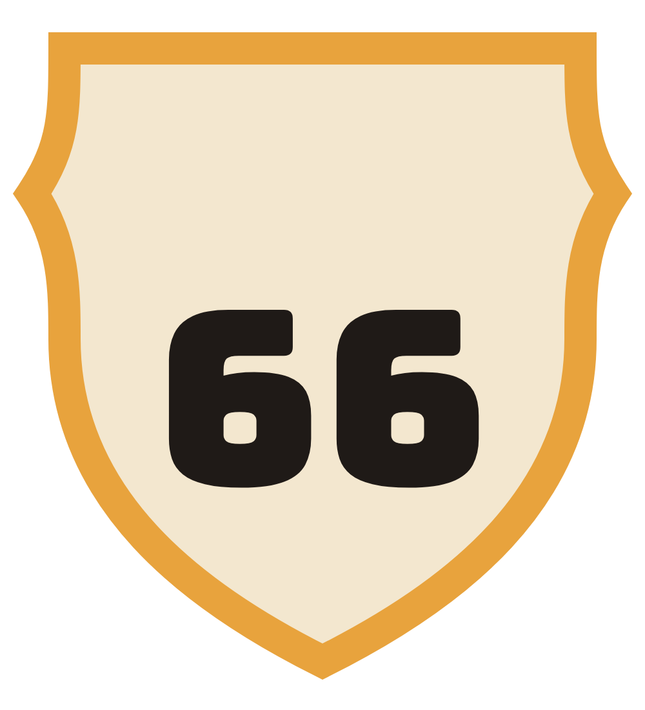

# Ridemaxxing-Client

## Design shit
[figma](https://www.figma.com/design/x5KdFDrs8wprMEj48sLR3q/PoolCar?node-id=0-1&t=hAzEFhK8FcaVKepO-1)

## Color Scheme

<table>
  <thead>
    <tr><th>Swatch</th><th>Color</th><th>Hex</th><th>Used for</th></tr>
  </thead>
  <tbody>
    <tr><td>
</td><td>Mustard gold</td><td><code>#E8A33D</code></td><td>Logo frame, top sunset stripe, odometer, Pay button</td></tr>
    <tr><td>
</td><td>Rust red</td><td><code>#A63D24</code></td><td>Main buttons, prices, active tab, end point</td></tr>
    <tr><td>
</td><td>Motel turquoise</td><td><code>#2E8B8B</code></td><td>Start point, avatars, route cards</td></tr>
    <tr><td>
</td><td>Asphalt</td><td><code>#211C19</code></td><td>Text, outlines, hard shadows, dark headers</td></tr>
    <tr><td>
</td><td>Asphalt (original set)</td><td><code>#1F1A17</code></td><td>Same role in the first Mother Road screens; logo "66"</td></tr>
    <tr><td>
</td><td>Cream</td><td><code>#F6EEDD</code></td><td>App background</td></tr>
    <tr><td>
</td><td>Paper</td><td><code>#FFFBF2</code></td><td>Cards, inputs, text on dark and rust</td></tr>
    <tr><td>
</td><td>Dusty brown</td><td><code>#5E4F42</code></td><td>Secondary text, labels, inactive tabs</td></tr>
    <tr><td>
</td><td>Desert sand</td><td><code>#EBD9B8</code></td><td>Map background</td></tr>
  </tbody>
</table>